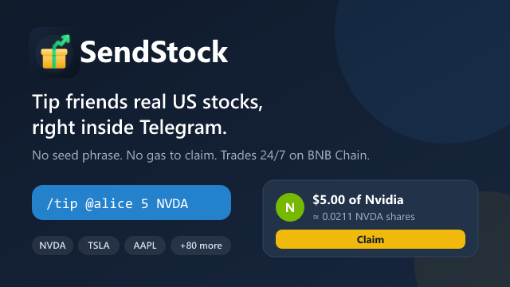

# SendStock

Tip your friends real US stocks, right in Telegram.

Message the bot `/send 5 NVDA`, pick a friend, and pay. Your friend gets $5 of Nvidia as a real tokenized stock (NVDAB, a Binance bStock on BNB Chain). They tap **Claim**, and it lands in their own wallet. No seed phrase, no gas.

In a group, `/tip @alice 5 NVDA` does the same thing in public.

- **Try it:** [@Sendstockbot](https://t.me/Sendstockbot) · [sendstock.website](https://sendstock.website)
- **Contract (BSC mainnet):** [`0xc6196B047901214437D9A4aB99024bc311050Ca1`](https://bscscan.com/address/0xc6196B047901214437D9A4aB99024bc311050Ca1)
- Built for BNB Hack: Tokenized Stocks Edition.



## How it works

1. **You tip.** `/send` in a DM (pick a friend from your contacts) or `/tip` in a group. The bot looks up the stock with Binance's RWA Data API and posts a card with the price and how many shares that is.
2. **You pay.** In the Mini App, one transaction swaps your USDT into the stock on PancakeSwap v3 and locks it in our escrow contract.
3. **They get a message.** The bot DMs your friend a claim link. If they have never opened the bot, you get a "Share with..." button to send it yourself.
4. **They claim.** Their wallet comes from their Telegram login (Privy). Our Binance Agentic Wallet sends the claim and pays the gas.
5. **Nobody claims?** The tip goes back to you after 7 days.

It works on weekends too. The US market might be closed, but the stock still moves on-chain.

## Stack

- **Binance Web3 RWA Data API:** ticker lookup, price, company info, market status
- **Binance Agentic Wallet:** escrow operator, sends claims (`baw contract-call`)
- **PancakeSwap v3:** picks the cheapest pool for each tip
- **TipEscrow** (Solidity, Hardhat 3): 21 unit tests, plus a test on a copy of mainnet with real USDT and NVDAB
- **Telegram bot** (grammY), **Mini App** (React + Privy), **API** (Hono)

## Repo

- `contracts/`: escrow, tests, deploy script
- `bot/`: Telegram bot, API, Agentic Wallet operator
- `app/`: the Mini App

## Run it yourself

You need Node 22.13+, a Telegram bot token, a Privy app with Telegram login, and an Agentic Wallet with Developer Mode on.

```bash
npm install
cp .env.example .env                        # fill it in
cd contracts && npx hardhat test solidity   # tests
cd ../bot && npm start                      # bot + API
cd ../app && npm run dev                    # Mini App (add ?mock=pay to preview outside Telegram)
```

## Good to know

- The escrow's operator (our Agentic Wallet) decides who can claim, based on Telegram's signed login. Senders can always take back unclaimed tips.
- Spot only. No leverage.

## Next

Email backup for wallets, paying from an existing wallet, and a group tip jar run by the Agentic Wallet.
